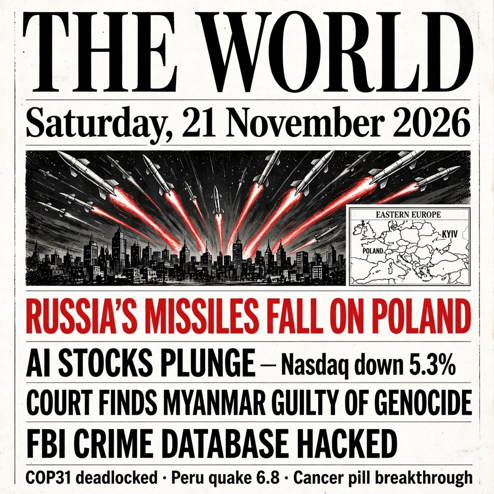

# The World — Saturday, 21 November 2026

One image that sums up the world's news of Saturday, 21 November 2026 — a newspaper front page.

## The day's news

- **Russia's missiles fall on Poland** — a massive overnight barrage (400+ drones, 110 missiles) hits Ukraine; two missiles and a suspected drone come down in Poland. PM Tusk calls it a deliberate provocation.
- **AI stocks plunge** — Nasdaq falls 5.3%, S&P 500 slips into correction as the AI sell-off deepens.
- **Court finds Myanmar guilty of genocide** — the International Court of Justice rules against Myanmar over the Rohingya.
- **FBI crime database hacked** — sensitive records accessed in a cyber breach.
- **COP31 talks deadlocked** over fossil fuels; **Peru shaken by a 6.8 quake**; **cancer pill breakthrough** in trial.

## How it works

`entry.png` is the image (1024×1024, under 1 MiB). `main.ts` (Node 22, standard library only) checks it against the gate's limits and copies it to `/output/entry.png`, where the judge reads it.

Built for the [make.fun](https://make.fun) news-image-20261121 bounty.

## License

MIT
